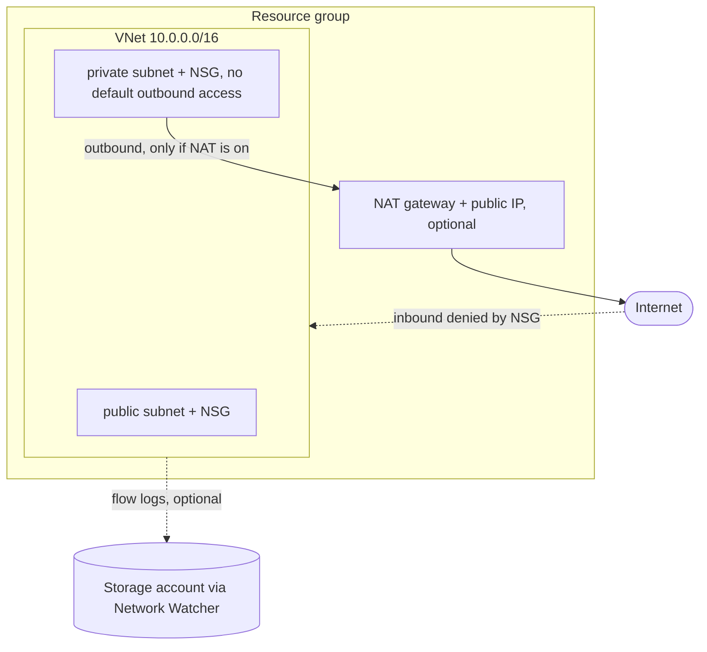

# Azure Network (VNet)

A resource group with a virtual network, a `public` and a `private` subnet, and a network security group per subnet. A NAT gateway and VNet flow logs are optional and off by default.

Network only: no compute, no database. It is the plain building block for workloads that you deploy afterwards. OpenTofu demo template. Standalone, no dependency on other repos. Compatible with Terraform.

## Architecture



- Resource group and VNet (default `10.0.0.0/16`)
- Subnets `public` and `private` (default `/24` each), public first. The names match the AWS template, but Azure subnets have no type: the two tiers differ by NSG and NAT gateway
- One network security group per subnet, each with an explicit rule that denies all inbound traffic from the internet
- NAT gateway with a static public IP on the private subnet (optional)
- VNet flow logs (optional) to a new storage account, using an existing Network Watcher
- Azure subnets span the region, so there is no availability zone setting

## Security

- NSGs deny inbound traffic from the internet on both subnets. Users add allow rules with a lower priority number
- The private subnet has no default outbound access: it reaches the internet only through the NAT gateway, if it is on
- `vnet_cidr` must be a private range (RFC 1918) between `/16` and `/24`, and the module checks that the subnets fit
- The flow log storage account enforces TLS 1.2 and HTTPS, forbids public blobs, denies network access except trusted Azure services and has blob soft delete

Accepted checkov findings (documented inline in the code, all on the optional flow log resources):

| Check | Reason |
|---|---|
| CKV_AZURE_33 | Queue service is not used |
| CKV_AZURE_59 | The firewall denies all traffic except trusted Azure services, which Network Watcher needs to write the logs |
| CKV2_AZURE_1 | Microsoft-managed keys, customer-managed keys are out of scope for the demo |
| CKV2_AZURE_33 | Network Watcher writes through the trusted services bypass, a private endpoint is out of scope |
| CKV2_AZURE_40 | Not verified that Network Watcher can write flow logs when shared key access is off, so the default is kept |
| CKV2_AZURE_41 | SAS tokens are not used |
| CKV_AZURE_12 | Retention is configurable (`flow_log_retention_days`), the default is 90 days and 0 keeps the logs forever |

The Trivy scan (`trivy config`) accepts findings with `#trivy:ignore` comments above the resource. The reason is written in the same line. Trivy evaluates the default values, so it checks the optional resources only when they are switched on (`--tf-vars`):

| Check | Reason |
|---|---|
| AVD-AZU-0057 | Access logging of the flow log storage account is out of scope for the demo |
| AVD-AZU-0061 | Infrastructure (double) encryption is out of scope for the demo, data is encrypted with Microsoft-managed keys |

## Usage

Sign in with `az login` and set `ARM_SUBSCRIPTION_ID` to the target subscription.

```bash
cp terraform.tfvars.example terraform.tfvars
tofu init
tofu plan
tofu apply
```

## Using the network

Deploy workloads into the `private` subnet (`private_subnet_id`) and resources that need public IPs into the `public` subnet. Turn on `enable_nat_gateway` when private workloads need outbound internet access.

## Flow logs

`enable_flow_logs = true` creates a storage account and a flow log on the VNet. It uses the Network Watcher that Azure creates per region (default `NetworkWatcher_<location>` in `NetworkWatcherRG`). If it does not exist or has other names, the run fails when it looks it up. Set `network_watcher_name` and `network_watcher_resource_group` in that case. This module does not create a Network Watcher, because Azure allows only one per region and subscription.

## Inputs

| Name | Description | Default |
|---|---|---|
| `name_prefix` | Prefix for all resource names | `"demo"` |
| `location` | Azure location | `"germanywestcentral"` |
| `advanced_settings` | Object with the settings below, all optional | `{}` |

`advanced_settings` attributes (shown as "Advanced Settings" in the StackGuardian form):

| Name | Description | Default |
|---|---|---|
| `vnet_cidr` | Address space of the VNet. Private range (RFC 1918), prefix `/16` to `/24` | `"10.0.0.0/16"` |
| `subnet_newbits` | Bits added to the VNet prefix for each subnet, 1 to 12. 8 gives `/24` subnets in a `/16`. The subnet prefix may not be longer than `/29` | `8` |
| `enable_nat_gateway` | NAT gateway with a public IP for the private subnet | `false` |
| `enable_flow_logs` | VNet flow logs to a storage account | `false` |
| `flow_log_retention_days` | Days to keep flow logs, 0 to 365, 0 keeps them forever | `90` |
| `network_watcher_name` | Existing Network Watcher, default `NetworkWatcher_<location>` | `null` |
| `network_watcher_resource_group` | Resource group of the existing Network Watcher | `"NetworkWatcherRG"` |
| `tags` | Additional tags for all resources | `{}` |

## Outputs

| Name | Description |
|---|---|
| `resource_group_name` | Name of the resource group |
| `vnet_id` | ID of the virtual network |
| `vnet_name` | Name of the virtual network |
| `vnet_cidr` | Address space of the virtual network |
| `public_subnet_id` | ID of the public subnet |
| `private_subnet_id` | ID of the private subnet |
| `public_subnet_cidr` | Address range of the public subnet |
| `private_subnet_cidr` | Address range of the private subnet |
| `nat_gateway_id` | ID of the NAT gateway, `null` when off |
| `nat_public_ip` | Public IP of the NAT gateway, `null` when off |

## Cost

The resource group, VNet, subnets and NSGs have no hourly cost. The NAT gateway and its public IP are billed per hour while they exist, plus data processing, even when idle, so the NAT gateway is off by default. Flow logs are billed for the storage and for the Network Watcher flow log data.

**Destroy after the demo:**

```bash
tofu destroy
```

## Tests

The GitLab pipeline (`.gitlab-ci.yml`) lints every push. Merge requests into `development` or `main` also run
validation, the checkov and Trivy scans and the unit tests. A tag runs all of these plus the integration tests, which deploy
real resources and destroy them again, and then creates a release. Integration tests run only when the CI/CD variables `AZURE_CLIENT_ID`, `AZURE_TENANT_ID` and `AZURE_SUBSCRIPTION_ID` are set: an app registration with a federated credential for GitLab OIDC and the audience `api://AzureADTokenExchange`.

In GitLab, the `unit-tests` job also publishes its results as a JUnit test report, which you find in the **Tests** tab of the pipeline and of the merge request. The script `ci/tofu-json-to-junit.py` converts the output of `tofu test -json` to JUnit XML.

The GitHub Actions workflow (`.github/workflows/ci.yml`) runs the same jobs: every push, pull requests into `development` or `main`, and tags. Set the three `AZURE_*` values as repository variables; the app registration then needs a federated credential for GitHub.

```bash
tofu test -test-directory=tests/unit
```

Test cases: [tests/README.md](tests/README.md)

## Development

```bash
pre-commit install
pre-commit run --all-files
```
